# FinOps Pack for Azure SRE Agent

**Turn [Azure SRE Agent](https://azure.microsoft.com/en-us/products/sre-agent) into a read-only FinOps
analyst.** The pack adds 15 skills, the `finops-investigator` agent, and 12 scheduled Live Reports.
Together they cover cost visibility, allocation, anomaly detection, optimization, commitments,
budgets, AI and SRE Agent spend, sustainability, and the monthly FinOps review. The guidance follows
the [Microsoft FinOps Framework](https://learn.microsoft.com/en-us/cloud-computing/finops/).


> **Note:** These skills are built for Azure SRE Agent and may not work with other coding agents.
> They are packaged as **skills + agents**; they make no changes to the SRE Agent product.

## Table of contents

- [Why this pack](#why-this-pack)
- [Architecture](#architecture)
- [Capabilities](#capabilities)
  - [Skills](#skills)
  - [The finops-investigator agent](#the-finops-investigator-agent)
  - [FinOps Framework coverage](#finops-framework-coverage)
- [Live Reports](#live-reports)
  - [Report catalog](#report-catalog)
  - [Report gallery](#report-gallery)
  - [Estimated cost](#estimated-cost)
- [Example prompts](#example-prompts)
- [Managed scope](#managed-scope)
- [Safety model](#safety-model)
- [Install](#install)
  - [Install with GitHub Copilot](#install-with-github-copilot)
  - [Automated deployment](#automated-deployment)
  - [Manual (portal)](#manual-portal)
  - [Installer for an existing agent](#installer-for-an-existing-agent)
  - [Permissions](#permissions)
- [Repository layout](#repository-layout)
- [Test](#test)
- [Contributing another plugin](#contributing-another-plugin)
- [Background](#background)
- [Acknowledgments](#acknowledgments)

## Why this pack

Cloud cost work usually means checking several portals, exporting spreadsheets, and rebuilding the
same analysis every month. This pack gives SRE Agent the procedures, deterministic Python helpers,
and report templates to do that work on a schedule and on demand:

- **One source of truth for scope.** Every run reads the agent's own managed resources, so reports
  never drift outside the boundary you configured.
- **Deterministic numbers.** Costs are computed by tested Python helpers, not estimated by the
  model, and reconcile with Azure Cost Management. In live validation every report matched Cost
  Management month-to-date amortized cost within 1.3%.
- **Honest data quality.** Each report shows a *Data quality* panel listing billing lag, missing
  permissions, partial data, and scope coverage instead of hiding gaps.
- **Recommend, never act.** Every Azure call is read-only. Savings are labeled as estimates, and
  every cost-affecting change needs a human decision.

## Architecture

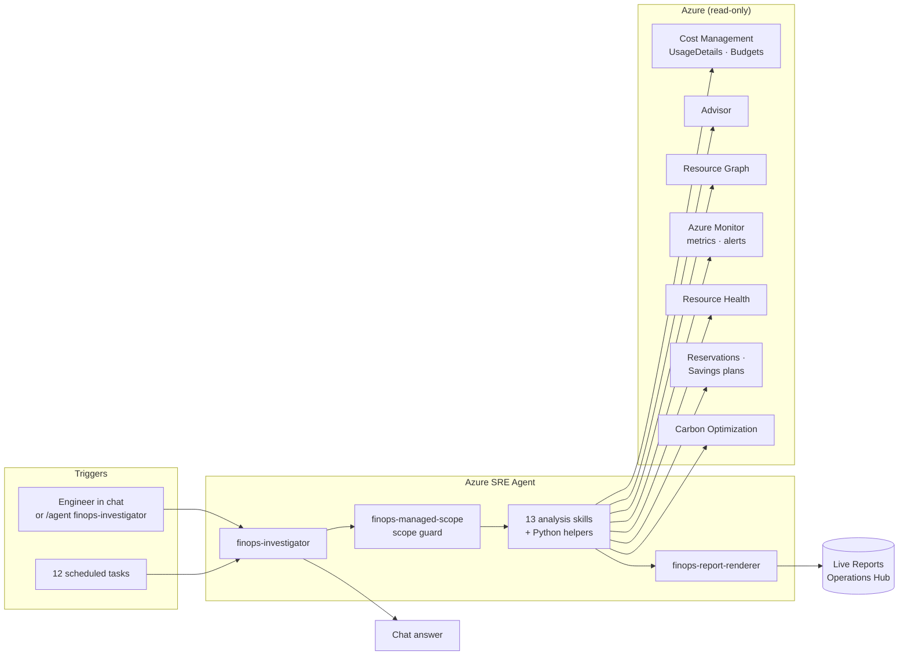

## Capabilities

### Skills

| Skill | What it does | Typical question |
|---|---|---|
| `finops-managed-scope` | Reads the agent's `managedResources`, expands management groups, filters UsageDetails to the exact boundary, and reports included, excluded, and unattributed cost. Used by every other skill. | *"Which subscriptions are you analyzing?"* |
| `finops-cost-anomaly-detection` | Detects daily cost spikes per service and meter, then correlates them with Azure changes (and GitHub deployments when configured). | *"Why did our bill jump on Tuesday?"* |
| `finops-cost-allocation` | Showback by owner, team, cost center, or another tag; shows tag coverage, inherited tags, untagged spend, and month-over-month change. | *"How much does each team spend?"* |
| `finops-rightsizing-advisor` | Validates Advisor cost recommendations against real CPU utilization and actual cost before recommending a smaller SKU or shutdown. | *"Which VMs are oversized?"* |
| `finops-waste-finder` | Finds orphaned and idle resources: unattached disks and public IPs, empty load balancers and gateways, dead private endpoints, old snapshots, stopped-but-allocated VMs. | *"What are we paying for that nobody uses?"* |
| `finops-commitment-advisor` | Reservation and savings plan inventory, utilization, expiry, coverage, purchase recommendations, and Azure Hybrid Benefit candidates. | *"Should we buy a savings plan?"* |
| `finops-budget-governance` | Checks every budget against its amount, forecast, and alert thresholds; flags budgets that need a decision. | *"Are we on track for budget?"* |
| `finops-budget-editor` | Proposes budget amounts and thresholds and produces a validated shell script **for a human to run**; the agent never applies it. | *"Create a budget for the data platform RG."* |
| `finops-for-ai` | Azure OpenAI, AI Foundry, Cognitive Services, and ML spend per resource and model, with token versus compute split. | *"What is our GPT-4o spend this month?"* |
| `finops-sre-agent` | Azure Agent Unit (AAU) spend per SRE Agent, always-on versus active flow, top threads, and monthly-limit headroom. | *"How much do our SRE Agents cost?"* |
| `finops-carbon-optimization` | Carbon emissions (kgCO2e) trend, top emitters, regions, and largest increases from Azure Carbon Optimization. | *"What is our cloud carbon footprint?"* |
| `finops-cost-vs-reliability` | Joins cost with alerts, Resource Health, and Advisor high-availability findings to show where spend and reliability pain overlap. | *"Where should we invest in reliability, and what can we safely cut?"* |
| `finops-kpi-scorecard` | Month-end and next-month forecast, unit economics, FinOps KPIs with a Crawl/Walk/Run maturity score, and one action list per owner. | *"Run our monthly FinOps review."* |
| `finops-cost-optimization-report` | Executive rollup of anomalies, rightsizing, waste, commitments, SRE Agent spend, budgets, and governance into one prioritized action list. | *"Give me a cost optimization summary for leadership."* |
| `finops-report-renderer` | Renders the structured results as escaped, CSP-safe Live Report HTML with metrics, charts, tables, and data-quality warnings. | *(used by scheduled tasks)* |

### The finops-investigator agent

`finops-investigator` is a dedicated subagent that you call with `/agent finops-investigator` in
chat, and it is the agent that runs all scheduled tasks. It:

- loads `finops-managed-scope` before every request and stays inside the managed boundary;
- picks the right skills for the question and ranks findings by dollar impact and operational risk;
- recommends usage optimization (rightsizing, waste) **before** rate optimization (commitments), so
  purchases are not sized to capacity that is about to be removed;
- routes findings to owners by their `owner` or `team` tags;
- separates savings, anomalous spend, budget exposure, and governance findings instead of adding
  unlike numbers together.

### FinOps Framework coverage

| FinOps domain | Capabilities in this pack |
|---|---|
| **Understand usage and cost** | Data ingestion with managed-scope filtering, allocation and showback, reporting and analytics, anomaly management |
| **Quantify business value** | Forecasting, budgeting, unit economics, KPI benchmarking |
| **Optimize usage and cost** | Workload optimization (rightsizing, waste), rate optimization (reservations, savings plans, Hybrid Benefit), licensing, cloud sustainability, AI and SRE Agent spend |
| **Manage the FinOps practice** | Monthly review cadence, maturity scoring, policy and tag governance, owner accountability |

## Live Reports

Each scheduled task saves or refreshes a **Live Report** in the SRE Agent Operations Hub. Reports
include a refresh timestamp, the managed scope, a data-quality panel, headline metrics, charts, and
ranked tables. They render on desktop and mobile.

### Report catalog

| Live Report | Schedule (UTC) | What you get |
|---|---|---|
| **FinOps: Cost Overview** | Daily 14:30 | Total spend, daily trend, top services and resource groups |
| **FinOps: Cost Anomalies** | Daily 14:00 | Detected spikes with cause, impact, and correlated changes; emails only when a spike is found |
| **FinOps: Budget Status** | Daily 16:00 | Each budget's spend, forecast, threshold status, and budgets that need a decision |
| **FinOps: Rightsizing Savings** | Mon 15:00 | Validated rightsizing and idle-resource savings, ranked, plus items to review |
| **FinOps: Cost Allocation** | Mon 15:30 | Showback by the best-populated ownership tag, unallocated spend, tag hygiene |
| **FinOps: Waste Cleanup** | Mon 16:30 | Orphaned, idle, and stale resources with monthly savings |
| **FinOps: Cost Optimization** | Mon 17:00 | Executive rollup with one prioritized action list |
| **FinOps: Commitments** | Mon 17:30 | Reservation and savings plan recommendations, coverage, unused commitment, Hybrid Benefit |
| **FinOps: AI Spend** | Mon 18:00 | AI cost by resource, model, and service; token versus compute |
| **FinOps: SRE Agent Spend** | Mon 18:30 | AAU cost per agent, always-on versus active flow, limit headroom |
| **FinOps: Cost vs Reliability** | Mon 19:00 | Cost versus alerts, Resource Health, and HA findings; invest and verify-before-cutting lists |
| **FinOps: Monthly Review** | 1st of month 15:00 | KPI scorecard, maturity, forecast, month-over-month variance, owner actions |

Schedules, names, and model tiers can be overridden at install time; see
[`task-manifest.json`](plugins/finops/scheduled-tasks/task-manifest.json).

### Estimated cost

Each report run uses SRE Agent active flow AAUs. In our lab measurements, a run used about 24–75 AAUs
(about $2.40–$7.50 at $0.10 per AAU). The default install (Cost Optimization only) was about $26 a month
of active flow. All 12 reports came to about $495 a month, on top of the agent's always-on cost. **These are
estimates only: your consumption will differ with your environment size, data volume, and model.** Enable
only the reports you need. See **[docs/COST.md](docs/COST.md)** for per-report estimates, the method,
and how to keep costs predictable.

### Report gallery

These reports use **fictional sample data** for a made-up "Contoso" estate; no customer data is shown.
[`docs/samples/generate_samples.py`](docs/samples/generate_samples.py) passes the sample data through the
same skill helpers and renderer that the scheduled tasks use, so each report looks exactly like a live one.
Click an image to view it full size, or **View as HTML** to open the interactive report. Source files are in [`docs/samples/`](docs/samples/).

<table>
  <tr>
    <td width="50%"><b>Cost Overview</b><br/><a href="docs/images/reports/cost-overview.png">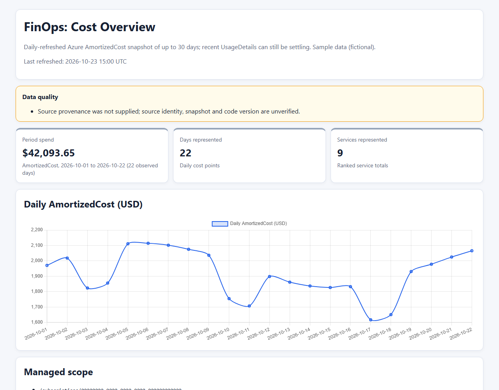</a><br/><a href="https://raw.githack.com/dmauser/finops-sre-agent-pack/main/docs/samples/cost-overview.html">View as HTML</a></td>
    <td width="50%"><b>Monthly Review (KPI scorecard)</b><br/><a href="docs/images/reports/monthly-review.png">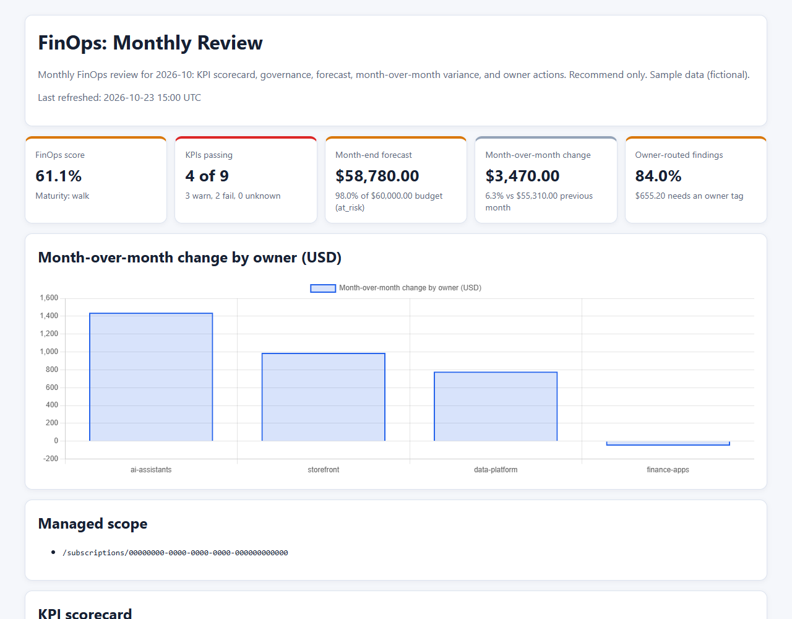</a><br/><a href="https://raw.githack.com/dmauser/finops-sre-agent-pack/main/docs/samples/monthly-review.html">View as HTML</a></td>
  </tr>
  <tr>
    <td><b>Cost Optimization</b><br/><a href="docs/images/reports/cost-optimization.png">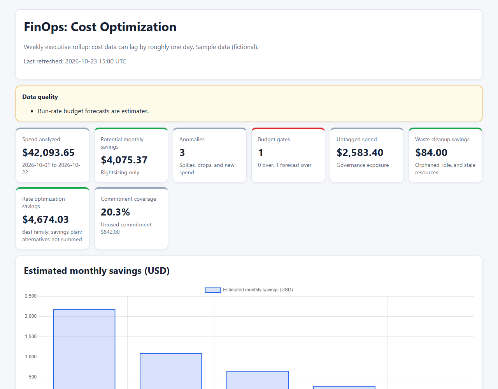</a><br/><a href="https://raw.githack.com/dmauser/finops-sre-agent-pack/main/docs/samples/cost-optimization.html">View as HTML</a></td>
    <td><b>Cost Anomalies</b><br/><a href="docs/images/reports/cost-anomalies.png">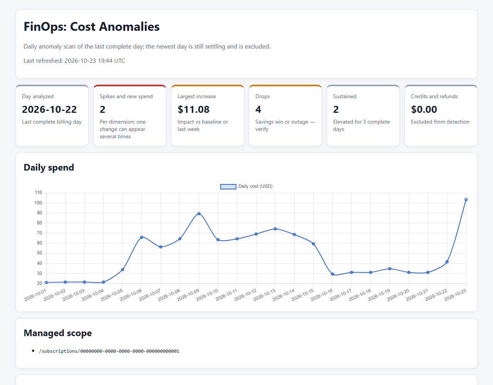</a><br/><a href="https://raw.githack.com/dmauser/finops-sre-agent-pack/main/docs/samples/cost-anomalies.html">View as HTML</a></td>
  </tr>
  <tr>
    <td><b>Budget Status</b><br/><a href="docs/images/reports/budget-status.png">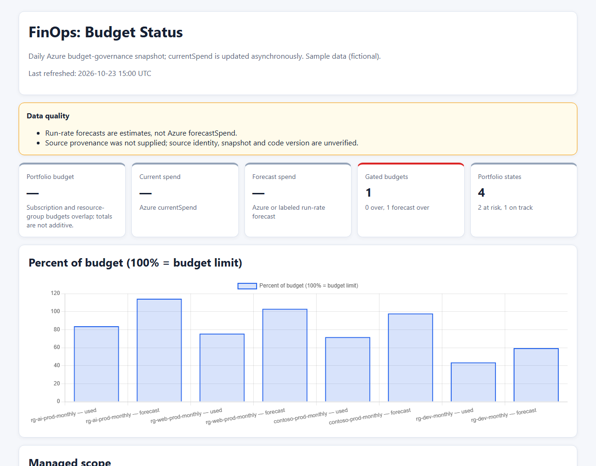</a><br/><a href="https://raw.githack.com/dmauser/finops-sre-agent-pack/main/docs/samples/budget-status.html">View as HTML</a></td>
    <td><b>Cost Allocation</b><br/><a href="docs/images/reports/cost-allocation.png">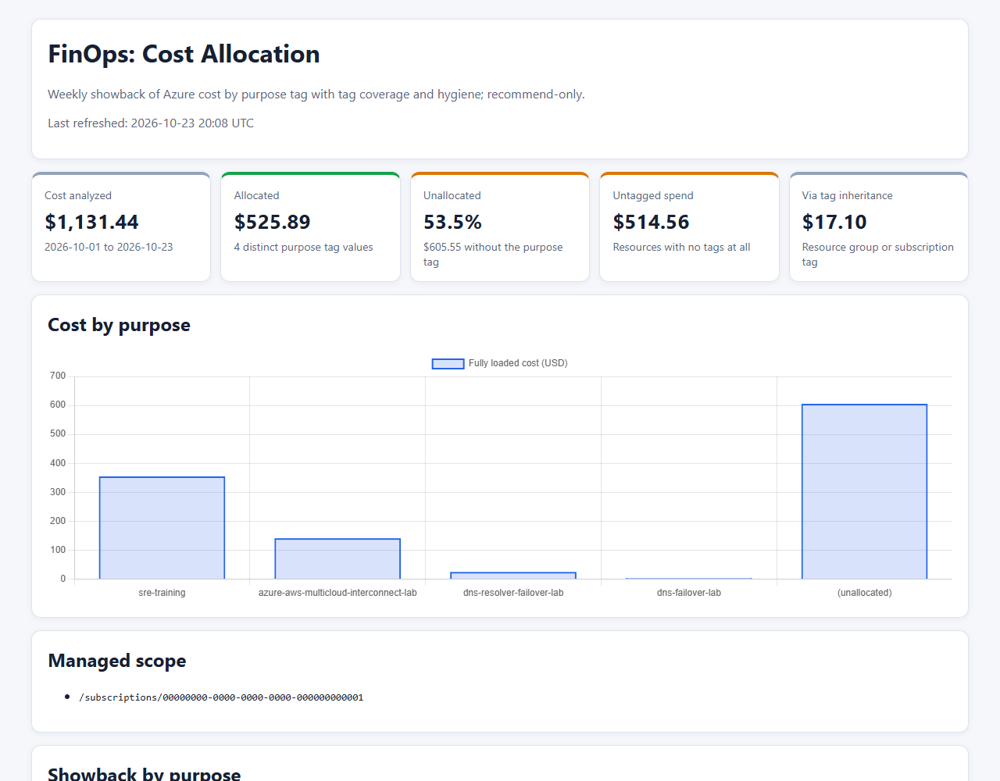</a><br/><a href="https://raw.githack.com/dmauser/finops-sre-agent-pack/main/docs/samples/cost-allocation.html">View as HTML</a></td>
  </tr>
  <tr>
    <td><b>Rightsizing Savings</b><br/><a href="docs/images/reports/rightsizing-savings.png">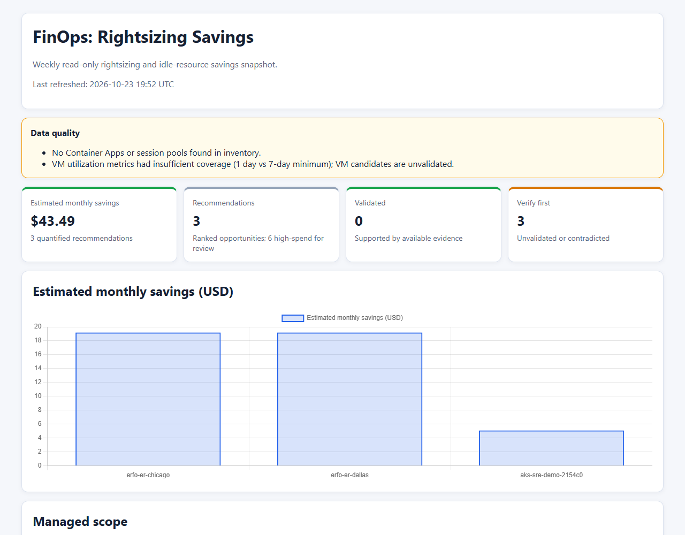</a><br/><a href="https://raw.githack.com/dmauser/finops-sre-agent-pack/main/docs/samples/rightsizing-savings.html">View as HTML</a></td>
    <td><b>Waste Cleanup</b><br/><a href="docs/images/reports/waste-cleanup.png">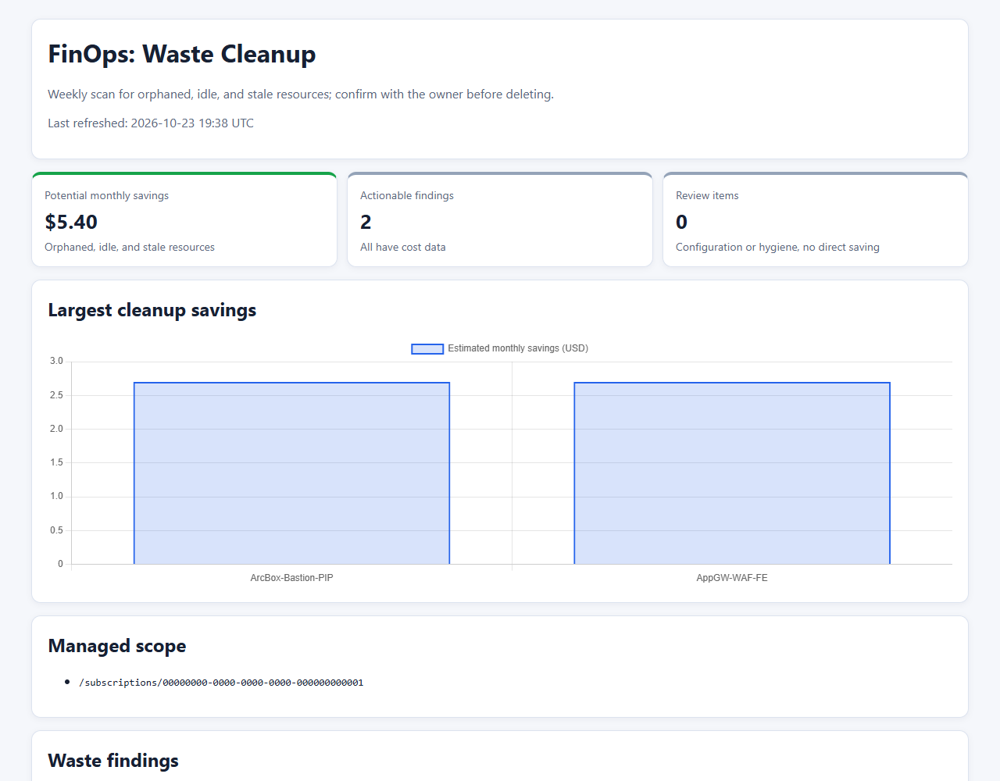</a><br/><a href="https://raw.githack.com/dmauser/finops-sre-agent-pack/main/docs/samples/waste-cleanup.html">View as HTML</a></td>
  </tr>
  <tr>
    <td><b>Commitments</b><br/><a href="docs/images/reports/commitments.png">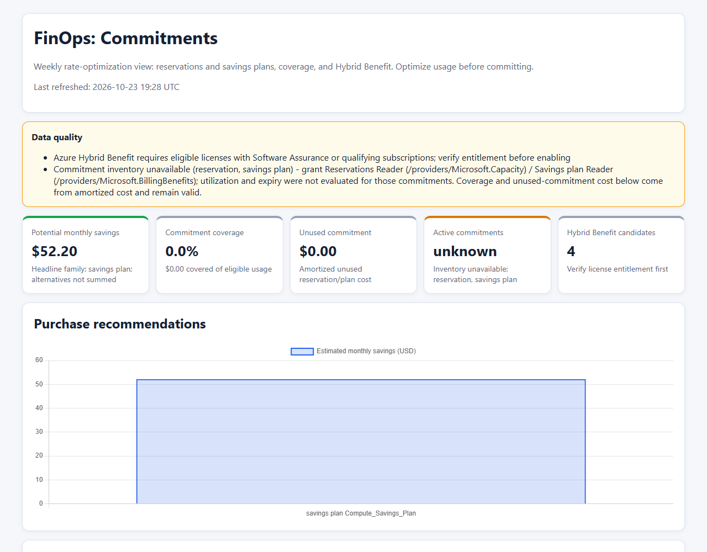</a><br/><a href="https://raw.githack.com/dmauser/finops-sre-agent-pack/main/docs/samples/commitments.html">View as HTML</a></td>
    <td><b>SRE Agent Spend</b><br/><a href="docs/images/reports/sre-agent-spend.png">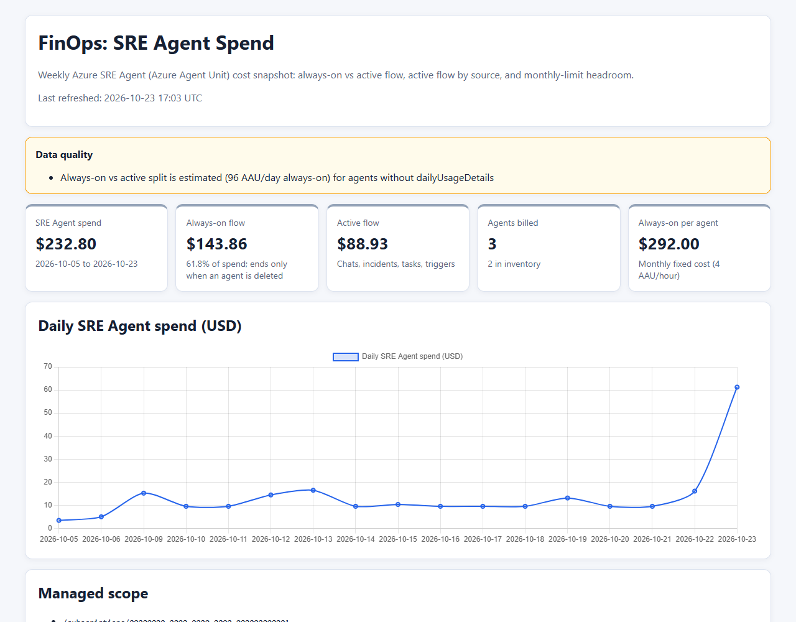</a><br/><a href="https://raw.githack.com/dmauser/finops-sre-agent-pack/main/docs/samples/sre-agent-spend.html">View as HTML</a></td>
  </tr>
  <tr>
    <td><b>Cost vs Reliability</b><br/><a href="docs/images/reports/cost-vs-reliability.png">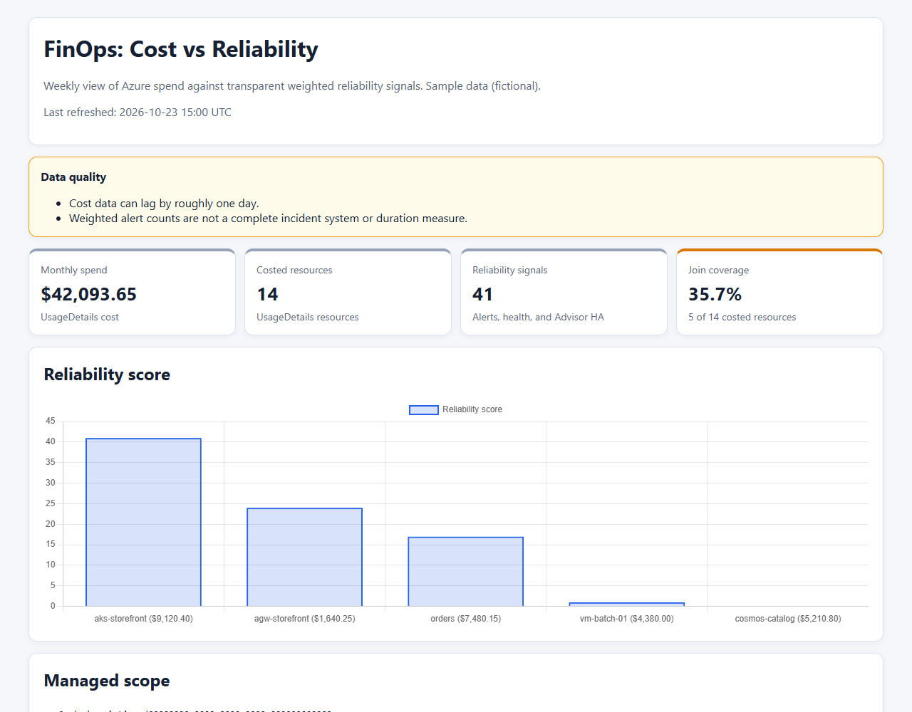</a><br/><a href="https://raw.githack.com/dmauser/finops-sre-agent-pack/main/docs/samples/cost-vs-reliability.html">View as HTML</a></td>
    <td><b>AI Spend</b><br/><a href="docs/images/reports/ai-spend.png">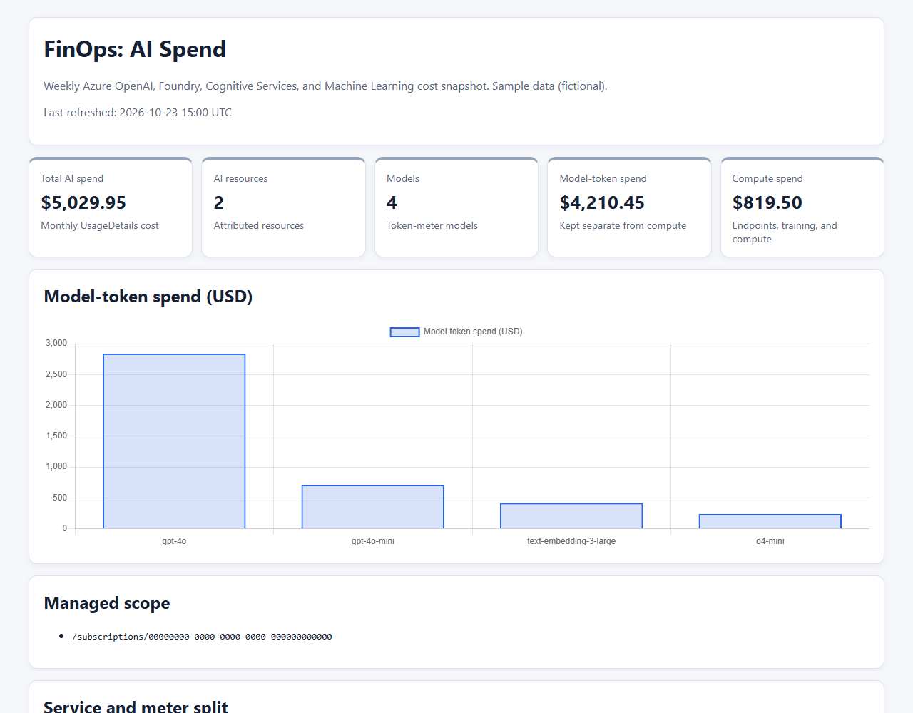</a><br/><a href="https://raw.githack.com/dmauser/finops-sre-agent-pack/main/docs/samples/ai-spend.html">View as HTML</a></td>
  </tr>
</table>

## Example prompts

Use these in SRE Agent chat, either directly or after `/agent finops-investigator`:

| Goal | Prompt |
|---|---|
| Explain a spike | *"Our Azure bill went up 40% yesterday. Find the cause and the change that triggered it."* |
| Showback | *"Break down this month's cost by team tag and list the biggest untagged resources."* |
| Quick savings | *"Find orphaned and idle resources and rank them by monthly savings."* |
| Rightsizing | *"Which VMs are oversized based on the last 7 days of CPU utilization?"* |
| Commitments | *"Do we have enough steady usage to justify a 1-year savings plan?"* |
| Budget check | *"Are any budgets forecast to go over this month?"* |
| New budget | *"Propose a monthly budget for rg-data with alerts at 80% and 100%."* |
| AI spend | *"What do our Azure OpenAI deployments cost per model this month?"* |
| Agent spend | *"How much are our SRE Agents costing, and how much is always-on?"* |
| Sustainability | *"Show our carbon emissions trend and the top emitting resources."* |
| Reliability trade-off | *"Where are we spending a lot but still getting paged?"* |
| Monthly review | *"Run the monthly FinOps review and give each owner their action list."* |
| On-demand report | *"Generate the Cost Allocation Live Report now."* |

## Managed scope

Every FinOps run reads `properties.knowledgeGraphConfiguration.managedResources` from the SRE Agent
ARM resource identified by `AGENT_RESOURCE_ID`. Subscription, resource-group, and management-group
scopes are supported. Change the agent's managed resources and the new boundary applies on the next
run; you do not need to reinstall the plugin.

- **Scheduled tasks** are bound to the current managed scope and fail closed: if scope discovery or
  management-group expansion fails, they do not query cost data, send email, or save a report.
- **Interactive requests** use the managed scope by default. A request outside it proceeds only
  after the exact outside scopes are shown and the user confirms them in a later turn.
- **Scope coverage** is disclosed: UsageDetails-based reports show included, excluded, and
  unattributed row counts and costs.
- **RBAC does not widen scope.** Broad inherited or historical role assignments do not expand the
  boundary. Installation does not revoke old broad grants.

## Safety model

| Guarantee | How it is enforced |
|---|---|
| Read-only Azure access | Azure is reached only through `RunAzCliReadCommands` and sandbox Python; the agent has no Azure write tool (report tools only save Live Reports) |
| No silent scope creep | `finops-managed-scope` filters every dataset; scheduled tasks fail closed |
| Human-in-the-loop changes | Budget changes are delivered as a reviewed script that a person runs with their own permissions |
| No invented savings | Estimates are labeled as estimates; rightsizing requires metric evidence |
| Transparent gaps | Each report lists billing lag, missing permissions, and partial data in a *Data quality* panel |

## Install

Choose one path. Every path installs the same plugin, skills, and `finops-investigator`; they differ in
whether they create the agent and how many scheduled tasks they add by default. See
**[docs/ONBOARDING.md](docs/ONBOARDING.md)** for the full guide. Each report adds active flow AAU cost, so enable
only the ones you need; see [Estimated cost](docs/COST.md).

| Path | Creates the agent | Default scheduled tasks |
|---|---|---|
| [Install with GitHub Copilot](#install-with-github-copilot) | Optional (runs `deploy.sh`) | You choose |
| [Automated deployment](#automated-deployment) (`deploy.sh`) | Yes, or reuses an existing one | Cost Optimization only (`--tasks all` for 12) |
| [Manual (portal)](#manual-portal) | Yes, by hand | The ones you create |
| [Installer for an existing agent](#installer-for-an-existing-agent) (`install-api.sh`) | No | All 12 (`TASK_IDS` to limit) |

### Install with GitHub Copilot

Let an AI coding agent run the install for you. This works with [GitHub Copilot CLI](https://github.com/features/copilot/cli)
or Copilot agent mode in VS Code, on a machine with `az`, `git`, `curl`, `python3`, and bash (WSL on
Windows). Sign in first with `az login`, then paste this prompt:

```text
Install the Azure SRE Agent FinOps pack from https://github.com/dmauser/finops-sre-agent-pack.

1. Clone the repository and read README.md and docs/ONBOARDING.md.
2. Check the prerequisites: az (signed in), git, curl, python3, bash. Show me the current
   subscription with `az account show` and confirm it is the right one.
3. Ask me whether to create a new SRE Agent or add the pack to an existing one.
   - New agent: ask for the agent name, Azure region, and resource group.
   - Existing agent: ask for the agent name and resource group.
4. Ask whether to schedule only the weekly Cost Optimization report (default) or all reports.
5. Run plugins/finops/deploy/deploy.sh with --dry-run first, show me the plan, and wait for my
   approval. Then run it for real, for example:
     ./plugins/finops/deploy/deploy.sh -n <agent> -l <region> -g <rg> [--tasks all]
   If the run fails because the service cannot clone the repository, re-run the same command
   once; deploy.sh is idempotent.
6. List the optional roles from the README "Permissions" table that are still missing
   (Reservations Reader, Savings plan Reader, Carbon Optimization Reader). They go to the
   agent's managed identity, not to my user: give the exact az commands using its principal ID
   with --assignee-principal-type ServicePrincipal, but do not run them without my approval.
7. Summarize what was installed, the roles that were granted, and each task's schedule. Remind
   me that no Live Report exists until a task runs, and explain how to use Run now and open
   Operations Hub > Live Reports in the SRE Agent portal.
8. If you changed my default az subscription, switch it back.

Do not modify or delete any existing Azure resources other than the SRE Agent you create or
the agent I name.
```

The agent asks before it creates anything, and the pack itself stays read-only after install (see
[Safety model](#safety-model)).

### Automated deployment

One command creates the SRE Agent (Bicep), installs the plugin from this repository with
auto-update, creates `finops-investigator`, and schedules the weekly Cost Optimization Live Report.
It prompts only for the agent name, region, and resource group:

```bash
./plugins/finops/deploy/deploy.sh            # add --tasks all for every report, -y for CI
```

To add the pack to an agent that already exists, run `deploy.sh -n <agent> -g <rg>`.

A new deployment creates exactly four resources in the resource group: the SRE Agent, a
user-assigned managed identity, a Log Analytics workspace, and Application Insights. The agent's
managed scope is the whole subscription. The script also grants the roles marked *deploy.sh* in
[Permissions](#permissions), including **SRE Agent Administrator** for you on the agent.

Optional settings (environment variables):

| Variable | Effect when unset |
|---|---|
| `ALERT_EMAIL` | No alert emails; findings appear only in task results and Live Reports |
| `GITHUB_REPO` | Cost changes are not correlated with GitHub commits and deployments |
| `COST_OPT_CRON` and the other `*_CRON` variables | Each task uses its schedule from [Live Reports](#live-reports) |
| `GRANT_COMMITMENT_READERS=1` | Reservations Reader and Savings plan Reader are not granted (needs tenant-level access) |
| `REPO_SLUG`, `GITHUB_PAT` | The plugin installs from this public repository |

#### First run and troubleshooting

- **No reports yet?** A Live Report is created on its task's first run. In
  [sre.azure.com](https://sre.azure.com), open the agent, go to **Scheduled tasks**, choose a FinOps
  task, and select **Run now**. Then open **Operations Hub → Live Reports**.
- **Plugin clone failed.** The agent service occasionally fails to clone the repository on the first
  attempt. Re-run the same `deploy.sh` command; it never re-provisions an existing agent and only
  upserts the configuration.
- **Data-plane 403 right after deployment.** The SRE Agent Administrator role can take a few minutes
  to propagate. The script retries automatically; if it still fails, wait and re-run.
- **`/agent finops-investigator` is missing in chat.** Start a new chat or hard-refresh the page.
- **Default subscription changed.** Passing `-s` runs `az account set`. Switch back afterward with
  `az account set --subscription <id>`.

### Manual (portal)

Create the agent, then use *Install from URL*, add the subagent YAML, and create the scheduled task
by hand. See [Option B](docs/ONBOARDING.md#option-b-manual-portal).

### Installer for an existing agent

`install-api.sh` installs the complete **`finops` plugin package**: all 15 skills,
`finops-investigator`, 12 scheduled tasks, and 12 Live Reports. It does not install unrelated
plugins from the marketplace. It requires `az`, `curl`, and `python3`, and `AGENT_RESOURCE_ID` is
mandatory so the managed scope can be discovered. Sign in with `az login` as an identity that can
manage the agent and create role assignments on it:

```bash
AGENT_RESOURCE_ID=/subscriptions/<sub>/resourceGroups/<rg>/providers/Microsoft.App/agents/<agent> \
  ./plugins/finops/install-api.sh
```

If the repository is private, provide a GitHub token so the agent service can clone it:

```bash
GITHUB_PAT="$(gh auth token)" \
AGENT_RESOURCE_ID=/subscriptions/<sub>/resourceGroups/<rg>/providers/Microsoft.App/agents/<agent> \
  ./plugins/finops/install-api.sh
```

See the [FinOps plugin documentation](plugins/finops/README.md#install-everything-recommended) for
all configuration options.

### Permissions

All roles except SRE Agent Administrator are assigned to the **agent's managed identity**, not to
your user account.

| Role | Scope | Granted by | Needed for |
|---|---|---|---|
| Reader | The agent ARM resource | deploy.sh, installer (always) | Reading `managedResources` |
| Reader, Log Analytics Reader | Subscription | deploy.sh | Resource Graph, Advisor, Monitor, Resource Health, logs |
| Cost Management Reader | Managed subscriptions | deploy.sh; installer when `MI_OBJECT_ID` is set | UsageDetails, budgets, forecasts |
| Monitoring Contributor | Subscription and the agent's resource group | deploy.sh | Standard SRE Agent monitoring setup. The only non-read role; the FinOps pack never uses it to write |
| SRE Agent Administrator | The agent (assigned to **you**) | deploy.sh | Data-plane access to configure the agent |
| Reader | Managed scopes | You (existing agents) | Resource Graph, Advisor, Monitor, Resource Health |
| Reservations Reader, Savings plan Reader | Tenant (`/providers/Microsoft.Capacity`, `/providers/Microsoft.BillingBenefits`) | You, or `GRANT_COMMITMENT_READERS=1` | Existing commitment inventory and utilization |
| Carbon Optimization Reader | Managed subscriptions | You | Carbon emissions analysis (`finops-carbon-optimization`) |

Grant the optional roles to the managed identity's principal ID (shown in the portal under the
identity, or with `az identity show --query principalId`):

```bash
MI=<managed-identity-principal-id>
az role assignment create --assignee-object-id $MI --assignee-principal-type ServicePrincipal \
  --role "Reservations Reader" --scope /providers/Microsoft.Capacity
az role assignment create --assignee-object-id $MI --assignee-principal-type ServicePrincipal \
  --role "Savings plan Reader" --scope /providers/Microsoft.BillingBenefits
az role assignment create --assignee-object-id $MI --assignee-principal-type ServicePrincipal \
  --role "Carbon Optimization Reader" --scope /subscriptions/<sub-id>
```

For a resource-group boundary, Azure exposes UsageDetails only at the subscription endpoint, so Cost
Management Reader is granted at that subscription while the pack still reports only the managed
resource groups. No budget-write permission is ever added.

## Repository layout

```text
plugins/finops/
├── skills/              # 15 skills: SKILL.md procedures + deterministic Python helpers
├── agents/              # finops-investigator subagent definition
├── scheduled-tasks/     # 12 task YAMLs, prompts, and task-manifest.json
├── deploy/              # deploy.sh + Bicep for the automated onboarding path
└── install-api.sh       # package installer for an existing agent
docs/                    # onboarding guide, sample reports, and report screenshots
evals/                   # evaluation scenarios
tests/                   # offline pytest suite
```

The structure mirrors [Azure/sre-agent-plugins](https://github.com/Azure/sre-agent-plugins).

## Test

```bash
pip install -r requirements-dev.txt
pytest tests/          # offline: scope guard, usage pipeline, renderer, installers, every skill helper
```

## Contributing another plugin

This section is for repository contributors, not an extra installation step:

1. Add the new plugin directory under `plugins/`.
2. Add its marketplace entry to [`.github/plugin/marketplace.json`](.github/plugin/marketplace.json).
3. Provide a plugin-specific installer or extend the package installer on purpose; the existing
   `plugins/finops/install-api.sh` installs only the `finops` package.

## Background

Every Azure data source the skills use was validated against a deployed SRE Agent, and the Live
Reports were reconciled with Azure Cost Management. Guidance is aligned with the
[Microsoft FinOps documentation](https://learn.microsoft.com/en-us/cloud-computing/finops/). See
[CHANGELOG.md](CHANGELOG.md) for release history and [SECURITY.md](SECURITY.md) to report issues.

## Acknowledgments

This project started from [nirmash/finops-sre-agent-pack](https://github.com/nirmash/finops-sre-agent-pack)
by [Nir Mashkowski](https://github.com/nirmash), which introduced the idea of packaging FinOps skills and
agents for Azure SRE Agent. This repository has since been developed independently. The original MIT
copyright notice is retained in [LICENSE](LICENSE).
